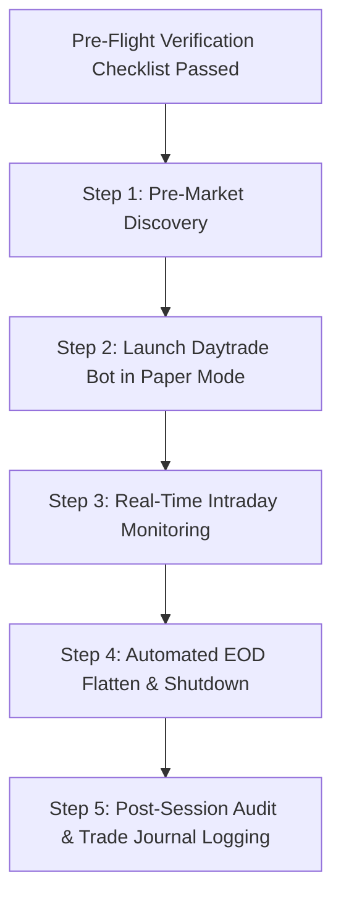

# Paper Trading Operational Runbook & Safety Protocols

**Version:** 1.0.0  
**Target Environment:** Alpaca Paper Trading Sub-Account  
**Trader Location:** Chiang Mai, Thailand (ICT, UTC+7)

---

## 1. Multi-Account Execution Safety (CRITICAL RULE)

> [!IMPORTANT]
> **DO NOT** run Day Trading (`daytrade-bot`) and Swing Trading (`paper`/`predict`) on the same single Alpaca account.
> 
> **Why**: Day Trading contains automated end-of-day flatten rules (`flatten_all()`) and intraday risk circuit breakers. When triggered, these API calls will wipe out all resting orders and close *every* open position on the account, accidentally liquidating long-term Swing trading positions.
> 
> **Rule**: Always use separate Alpaca Sub-accounts (with separate API keys) to keep Day Trading and Swing Trading assets completely isolated.

---

## 2. Trading Schedule & Thailand (ICT, UTC+7) Timezone Reference

| Session Phase | Summer / Fall (EDT / Daylight Saving) | Winter / Spring (EST / Standard Time) | Notes |
| :--- | :--- | :--- | :--- |
| **Pre-Market Scanner** | 8:00 PM – 8:15 PM ICT | 9:00 PM – 9:15 PM ICT | Scans universe, identifies gap & momentum anchors |
| **Regular Market Trading** | 8:30 PM – 3:00 AM ICT (next day) | 9:30 PM – 4:00 AM ICT (next day) | Automated ORB, VWAP, Mean Reversion execution |
| **Mandatory EOD Flatten** | 2:55 AM ICT (next day) | 3:55 AM ICT (next day) | All intraday day-trading positions closed before bell |

---

## 3. Pre-Flight Verification Checklist

Before starting any paper trading session, verify each checklist item:

- [ ] **Working Tree Status**: Clean working directory (`git status --short` is clean).
- [ ] **Git Checkpoint**: Stable checkpoint tag verified (`v3-clean-engine-checkpoint-2026-08-17`).
- [ ] **Account Mode**: `.env` is configured with **Alpaca Paper Credentials** only (`https://paper-api.alpaca.markets`).
- [ ] **Account Isolation**: `DAYTRADE_APCA_API_KEY_ID` belongs to the isolated Day Trading sub-account.
- [ ] **Account Guard**: `ASSERT_ACCOUNT_TYPE = True` in `config.py`.
- [ ] **Risk Guardrails**: `ACCOUNT_MAX_DRAWDOWN_PCT = 0.10` and `MAX_DAILY_LOSS_DAYTRADE = 300.0` configured.
- [ ] **Breakeven & Noise Floor**: `BREAKEVEN_LOCK_ENABLED = True` and `NOISE_FLOOR_HARD_VETO_RATIO = 0.75`.
- [ ] **Open Position Audit**: Run `python scripts/one_off/check_positions.py` to confirm no unexpected residual positions.
- [ ] **Test Health**: Priority unit test suite passing (`python -m pytest --no-cov tests/test_p0_critical.py ...`).
- [ ] **Dangerous Scripts Offline**: `scripts/dangerous/buy_amzn.bat` is quarantined and NOT executed.

---

## 4. Session Execution Workflow



### Step 1: Pre-Market Discovery (8:00 PM ICT EDT / 9:00 PM ICT EST)
Execute the read-only market scanner:
```powershell
python scripts/one_off/verify_full_market_scanner.py
```

### Step 2: Launch Daytrade Paper Bot (8:25 PM ICT EDT / 9:25 PM ICT EST)
Launch the primary runner from project root:
```powershell
.\run_daytrade_paper.bat
```
*(Keep this console window open and visible for the first 30–45 minutes of market open).*

### Step 3: Monitor Live Intraday Execution
Check console output and logs for:
- Initial capital and connection confirmation.
- Filter approvals/rejections (SOXX gate, SPY trend guard, RS threshold).
- Bracket order submissions (Limit entry + OCO GTC Stop / Take-Profit).
- Trailing stop updates and breakeven lock activations.

### Step 4: Emergency Stop & Manual Intervention
If unexpected behavior, broker API latency, or runaway orders occur:
1. Press `Ctrl + C` in the running bot terminal.
2. Check position status:
   ```powershell
   python scripts/one_off/check_positions.py
   ```
3. Cancel all working orders if required:
   ```powershell
   python scripts/one_off/cancel_open_orders.py
   ```

---

## 5. Post-Session Audit & Quantitative Promotion Gates

After each session, audit the trade log:
* Inspect `reports/` and `data/trade_journal.json`.
* Verify slippage between order price and fill price.

### Promotion Thresholds (Paper -> Real Money Migration)
Before migrating to real money live trading, run:
```powershell
python scripts/one_off/evaluate_paper_results.py
```

All 5 quantitative criteria **must be strictly met**:

| Metric | Minimum Threshold | Purpose |
| :--- | :--- | :--- |
| **Statistical Validity** | $N \ge 30$ closed trades | Ensures statistical significance across varied market regimes |
| **Profit Factor** | $PF \ge 1.25$ | Gross Profits / Gross Losses exceeds minimum profitability bar |
| **Win Rate** | $WR \ge 40\%$ | Validates edge in win/loss trade distribution |
| **Max Drawdown** | $\text{Max Drawdown} \le 5\%$ | Strict intraday trade-by-trade capital protection |
| **Execution Slippage** | $\text{Avg Slippage} \le 0.05\%$ | Validates liquid execution without excessive spread penalty |

> [!CAUTION]
> If **any single threshold** fails to meet the minimum bar, the strategy remains in Paper Trading mode. Live capital deployment is strictly prohibited until audited and approved.
